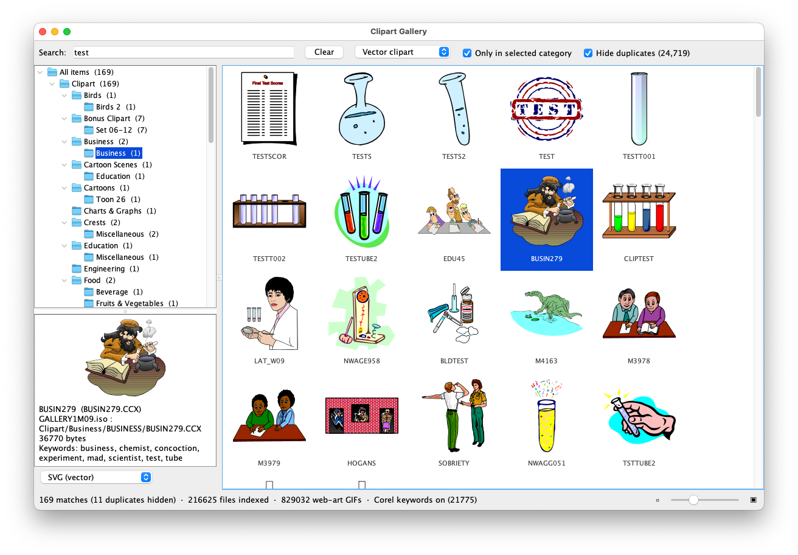

# Clipart Gallery (Corel Gallery replacement)

Vibe coded with Claude.

Discs can be downloaded from https://archive.org/details/corel_gallery_1000000_win95.

Pure Java 17+ / Swing, no dependencies.

    ./gradlew build
    java -jar build/libs/CorelGallery.jar

(or `./gradlew run`). The Gradle wrapper downloads Gradle itself on first use; only a JDK 17+ is needed.

1. Click **Add discs…** and choose the folder with GALLERY1M01–14.iso (scans take a minute per disc; results are cached in ~/.corelgallery).
2. Type keywords. Corel's own keyword database (disc 1) is used, plus file/folder names. Terms are ANDed; `-word` excludes; `ext:ccx` filters by type.
3. Select a thumbnail, pick SVG / PDF / EPS / PNG / original, **Export…**. You can also drag a thumbnail into Finder.

Supported: .ccx/.cmx vectors (own decoder), BMP/PNG/JPG/TIFF, and Corel .WI photos. Not yet: text objects inside CCX, .cdr/.wmf/.emf.

**.WI photos.** The WI codec is proprietary; its only implementation is `Gallery/Programs/swi32.dll` on disc 1.
`X86Vm` is a small pure-Java 32-bit x86 interpreter that runs that DLL's decoder, so no Windows or native code is needed.
The DLL is read from your own disc 1 (cached as `~/.corelgallery/swi32.dll`) and is never bundled. Add disc 1 as a source,
or point to a copy with `-Dgallery.swi32=/path/swi32.dll`. Decoding takes about half a second per photo; thumbnails are cached.
Output was verified pixel-identical to the DLL running natively-emulated on 10 sample photos.

## Using it
- **Tree** (left): folders merged across all discs, with counts for the current type filter. Click one to browse it; the search box narrows within it. The **Only in selected category** checkbox (top bar) controls this: checked = search just that folder and its sub-folders, unchecked = search everything. Clicking a folder turns it back on. While you type a search, the tree shows only folders that contain matches (counts are match counts) and expands them; clear the search to get the full tree back. Selecting an item in the grid expands the tree and highlights the folder it lives in (this doesn't change the search scope).
- **Slider** (bottom right): thumbnail size.
- **Quick Look**: select an item and press space (or double-click) for a full-window preview. Arrow keys browse, space/esc closes.
- **Export**: choose a format and press Export. Only PNG asks for a size. SVG is written 1024 units wide, PDF/EPS 8 inches.
- **Long names:** Corel's `CATALOG.CFG` (folder titles) and `Longname.cfg` (file names, e.g. `Brefcse2.tif` = "Briefcase") are read when discs are scanned and cached in `~/.corelgallery/names.ser`. Long names show in the grid, Quick Look, tree and exports, and are searchable. Only disc 1 carries them (Frames, Objects); the clipart and photo folders (e.g. `Hallowee`, `China_~1`) have no longer names on the discs.
- **Duplicates:** when the same picture exists in two formats (the .tif/.bmp pairs in disc 1's Objects folders) or on several discs (a few .jpg), only one copy is listed: vector, then .wi, .tif, .png, .jpg, .bmp. Corel's keywords from either copy are kept.
- **Hide duplicates:** the same drawing often appears in several folders and on several discs (Bonus/Xtra, Misc/clipartN, NAxxxx vs named copies). On the first run the app reads the small preview bitmap (the `DISP` chunk) stored in every CCX file (about 40 s for all discs, with a progress bar in the status bar) and groups files whose previews look the same: same-named files may differ slightly (anti-aliasing, redrawn geometry), differently named files must be practically identical, recoloured copies are never merged, and differently named files in one folder (alphabet letters, calendar days, symbol sets) are never merged. From each group the copy with the smoothest geometry (most Bezier curves, then most shapes) is shown and the others are hidden. The result is cached in `~/.corelgallery/dupes.ser`. The checkbox "Hide duplicates (N)" in the top bar turns it on and off, the status line says how many were hidden from the current results, and the details panel of a shown item lists the copies hidden behind it.
- **Copy and context menu:** select an item and press Cmd/Ctrl+C to put it on the clipboard as an image (vectors are rendered at the PNG size you last used, default 1024 px, with a transparent background; bitmaps at native size). Right-click an item for Copy Image, Copy as File (SVG/PNG/GIF, for pasting into Finder), Quick Look, Export As (any format) and Export…
- **Layout:** left column = category tree, with preview, details and export underneath; thumbnails fill the rest.
- **Web art (GIF):** the ~830,000 GIFs on discs 2-6 (buttons, arrows, bullets, backgrounds, animations under `WEBART/ANIMATED`) have their own filter, "Web art (GIF)". They are kept in a compact separate index (`~/.corelgallery/webart.ser`, ~19 MB), so the normal "All types" list stays clipart and photos only. Searching and the folder tree work as usual (search "oval yellow", or `-term` to exclude). Animated GIFs play in the preview and in Quick Look; export them with "Original file from disc" to keep the animation (PNG gives the first frame), and dragging a GIF out copies the original. A few hundred GIFs (mostly arrows on disc 2) are zero-filled in the disc images themselves and show "blank in the disc image".
- **Folder name translation:** Corel's folder names are abbreviated and inconsistent in case (`Helicopt`, `AIRCRAFT`, `Spec_occ`, `Hallowee`, or just `105000`). `src/main/resources/gallery/catalog/folder-names.tsv` (about 1,100 entries; plain text, easy to edit) maps them to readable titles (Helicopters, Aircraft, Special Occasions, Halloween, Lions). Lookup order: Corel's own `CATALOG.CFG`, then the table (full path, `parent/name`, `name`), then an automatic tidy-up (case, underscores, "Roman1" to "Roman 1"). The titles show in the tree and are searchable, so "helicopters" finds the `Helicopt` folder. Names were worked out from file names, Corel's keywords and sample images; the numeric photo folders (75) and the web-art button styles were all checked by eye. Edits take effect the next time the app starts (the search index is rebuilt at every start; no cache rebuild needed). An optional third column adds search keywords that are not shown (synonyms, singulars), e.g. `christma` → "xmas holiday".

## License
MIT, see [LICENSE](LICENSE). This covers the code only. Corel Gallery's artwork, keyword database and `swi32.dll` belong to Corel and are not included; the app reads them from your own discs.
